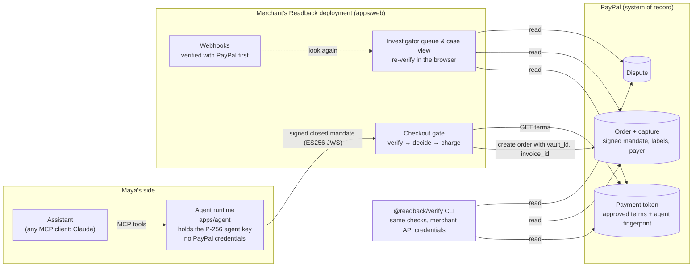
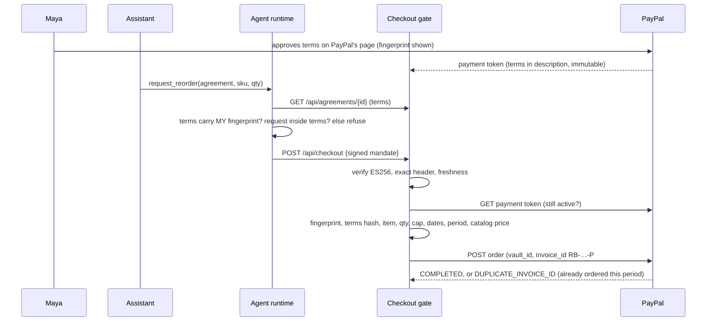
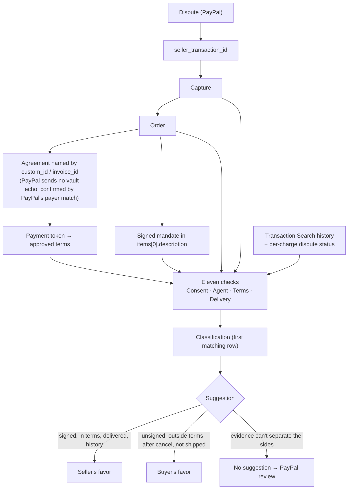

# Architecture: PayPal is the system of record

Readback stores nothing. Every fact it uses lives in PayPal; every decision is deterministic code in `packages/readback-core` that runs the same on the server and in the browser.

## Components and trust

- **Claude never decides.** It drafts terms (validated, then confirmed by Maya), writes a cited brief (validated), and maps a queue question to a named filter. Allow/deny and every suggestion come from `readback-core`.
- **Keys.** Only the agent runtime holds a private key. The merchant app and the investigator only verify. Judge mode's in-tab key is non-extractable and lives only in that tab (THREAT-MODEL T31).

## One purchase, end to end

## A dispute, end to end

The chain is followed through PayPal, never through merchant labels; labels are cross-checks. Merchant-written evidence can count against the merchant but never earns a seller-side suggestion (ADR 0004).

## Where each rule lives

| Rule | File |
|---|---|
| Terms grammar, canonical form, ≤127 chars | `packages/readback-core/src/terms.ts` |
| Money as integer cents | `money.ts` |
| ES256 compact JWS, exact header members | `jws.ts` |
| Agent fingerprint (RFC 7638) | `thumbprint.ts` |
| Closed mandate: verify, fit the terms, freshness, pre-check before signing | `mandate.ts` |
| Gate decision and the exact Orders request body | `gate.ts` |
| Labels (`invoice_id`, `custom_id`) and deterministic request IDs | `ids.ts` |
| The eleven checks | `checks.ts` |
| Classification and modifiers | `classify.ts` |
| Four lights | `lights.ts` |
| Action proofs (revoke, demo direct charge) | `action.ts` |
| Setup-token request (terms + display-only plan) | `setup.ts` |
| Reading a case from PayPal | `packages/verify-cli/src/cases.ts` |
| Agent runtime tools | `apps/agent/src/runtime.ts` |

## Verification

| What | How |
|---|---|
| Unit and property tests | `pnpm test` (core ~98% coverage; 10,000-mutation tamper property) |
| Same code in a real browser | `pnpm test:browser` (headless Chromium) |
| Labeled scenarios | `pnpm eval`, or `/judge` in the browser |
| Real server, browser, PayPal fake | `pnpm --filter @readback/web test:e2e` (judge flow + axe-core, light and dark) |
| Real PayPal behaviour | the public spike record, `docs/decisions/0001-sandbox-spike.md` |
