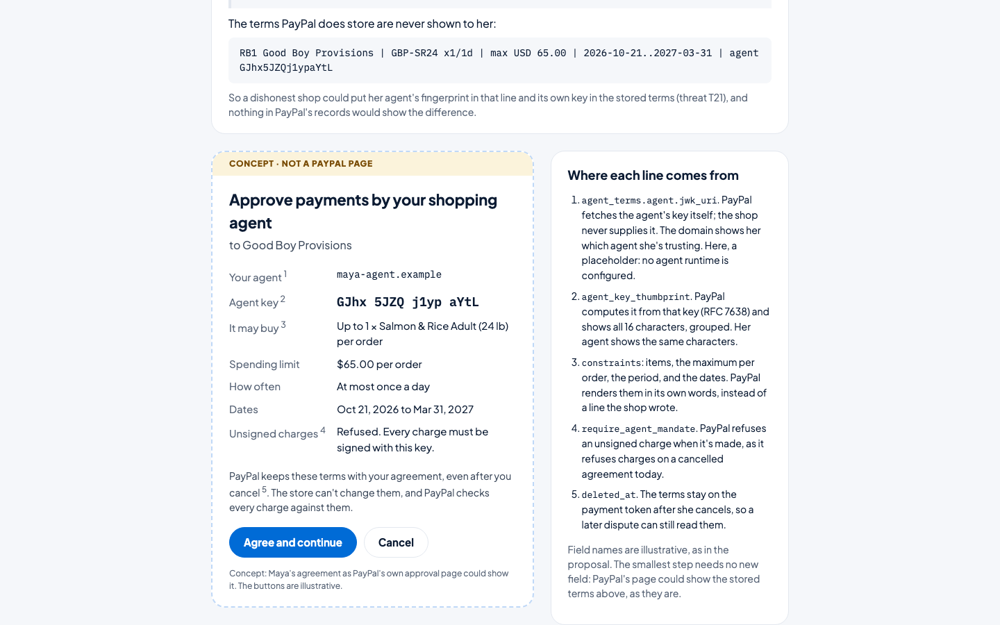

# Proposal: `agent_terms` on PayPal Vault payment tokens

*The one change PayPal would make to run Readback natively. **This is a proposal, not an existing PayPal API.** Field names are illustrative. It is written against the public Payment Method Tokens v3 spec (`vault_payment_tokens_v3.json`, v3.4), where `paypal_wallet_request` is `wallet_base` plus `billing_plan` and `experience_context`.*

## Headline: PayPal erases the consent record at the moment a dispute needs it

We filed the "my AI bought that" claim twice in the sandbox, on separate test agreements, both times through the buyer's own "I suspect the subscription or recurring payment was set up by someone else" option (spike step 7, Oct 26–27):
- **Run 1.** PayPal recorded the claim as `UNAUTHORISED` (`PP-R-QMJ-10194712`), and within 30 minutes deleted the agreement: its payment token returns 404.
- **Run 2.** The buyer completed PayPal's "Secure your account" step. The same happened (`PP-R-YOK-10194719`): the token was there at filing and gone about 3 minutes later.

From then on, the only copy of what the shopper approved is the one the merchant wrote on each order. An honest investigator can't rule for the merchant on the merchant's own copy, and Readback, by design, doesn't. So today, the claim itself destroys the evidence that would settle it. That's why our demo never files a claim on Maya's agreement: its two verdicts are read in preview, while the agreement is still alive.

The fix is one field: keep `agent_terms` on the deleted token, with `deleted_at` (section 2 below). Everything else in this proposal makes the record stronger; this part makes it survive.

## Why

Readback runs on today's rails. Four gaps remain because the merchant, not PayPal, carries some facts. Each was measured against the sandbox (`docs/decisions/0001-sandbox-spike.md`, 2026-10-15 to 2026-10-27):

| Gap | Today | Threat |
|---|---|---|
| The agent key fingerprint is written into the terms by the merchant's setup flow | A dishonest merchant could insert its own key | T21 |
| PayPal's approval page shows only the merchant-supplied `billing_plan.name`, never the stored `description` | The buyer can't see the terms PayPal actually stores; a merchant can show her fingerprint and store its own | T21 |
| Orders don't say which saved agreement paid (no `attributes.vault.id` on a vault charge) | The link rests on merchant labels plus PayPal's payer match; a charge with labels and mandate stripped can't be linked from merchant-side data | T3 |
| Terms disappear when the agreement is deleted, and an unauthorized claim deletes it within minutes (spike step 7) | Readback falls back to merchant-written copies and withholds seller-favor outcomes, exactly when a dispute needs them | T10 |
| The signed mandate rides in a merchant-written order field | A merchant can omit it; Readback detects that after the fact | T3, T24 |

Each gap closes if PayPal holds the agent terms itself, fetches the agent's key itself, records whether each charge was signed, and **shows the stored terms on its approval page**. The last part needs no new field: displaying the existing `description` (or echoing `vault.id` on vault orders) would already narrow T21 and T3 today.

## The change

### 1. Setup token: accept agent terms

```yaml
# components/schemas/paypal_wallet_request  (proposed addition)
paypal_wallet_request:
  allOf:
    - $ref: '#/components/schemas/wallet_base'
    - properties:
        billing_plan: { ... }            # unchanged
        experience_context: { ... }      # unchanged
        agent_terms:                     # NEW, optional
          $ref: '#/components/schemas/agent_terms_request'

agent_terms_request:
  type: object
  required: [agent, constraints]
  properties:
    agent:
      type: object
      required: [jwk_uri]
      properties:
        jwk_uri:        { type: string, format: uri }   # PayPal fetches the key; the merchant never supplies it
        display_name:   { type: string, maxLength: 64 }
    constraints:
      type: object
      properties:
        items:
          type: array
          items: { type: object, properties: { sku: { type: string }, max_quantity: { type: integer } } }
        max_amount_per_order: { $ref: '#/components/schemas/money' }
        period:               { type: object, properties: { interval_unit: { enum: [DAY, WEEK, MONTH] }, interval_count: { type: integer } } }
        not_before:           { type: string, format: date }
        not_after:            { type: string, format: date }
    require_agent_mandate: { type: boolean, default: true }   # refuse unsigned charges
    ap2_open_mandate:      { type: string }   # optional: accept an AP2 v0.2 open mandate (SD-JWT) directly
```

**Behavior at approval:**
- PayPal fetches the agent's public key from `jwk_uri` and computes the RFC 7638 thumbprint.
- PayPal's approval page shows the agent's display name, its domain, the thumbprint, and the constraints, in PayPal's own words.
- The display name and domain come from the **fetched agent document**, not from the merchant's request. The merchant does still choose `jwk_uri`, so a merchant could point at a rogue agent endpoint it controls. Showing the agent's domain makes that visible to the shopper; fully closing it is an open question (below).

**What the shopper would see.** `/proposal` on the demo is a labeled concept of this page. It is built from the terms PayPal stores for Maya's agreement, read live, and shows three things:
- the line PayPal's page shows today (the merchant-written plan name);
- the stored `description`, which PayPal never shows her;
- the proposed page, with each line tied to the field above that would supply it.



### 2. Payment token: return them, and keep them

```yaml
# components/schemas/paypal_wallet_response  (proposed addition)
agent_terms:
  allOf:
    - $ref: '#/components/schemas/agent_terms_request'
    - properties:
        agent_key_thumbprint: { type: string }            # computed by PayPal
        approved_at:          { type: string, format: date-time }
        deleted_at:           { type: string, format: date-time }   # retained after the shopper cancels
```

### 3. Orders: carry the mandate, record PayPal's verdict

```yaml
# payment_source.paypal (Orders v2, proposed addition)
agent_mandate: { type: string }   # compact JWS (or AP2 closed mandate), signed by the agent key

# capture (Payments v2, proposed addition, readOnly)
agent_verification:
  type: object
  properties:
    status:  { enum: [VERIFIED, FAILED, ABSENT] }
    reasons: { type: array, items: { type: string } }   # e.g. KEY_MISMATCH, OVER_CAP, OUTSIDE_PERIOD
```

**Behavior at charge time:**
- PayPal verifies the mandate against the stored terms.
- With `require_agent_mandate: true`, PayPal refuses an unsigned or failing charge, the same way it refuses charges on a cancelled agreement today.
- The verdict is recorded on the capture and exposed on the dispute's `disputed_transactions[]`.
- **The buyer's receipt shows the signature in words, not as a string.** Today the mandate has to ride in the item description, the only order field that holds it and returns it whole (spike step 1). So the buyer's receipt prints it as a long unreadable JWS (spike step 7, Oct 26). With `agent_mandate` as its own field, the receipt can say "Signed by your agent GAX4 1xq- rZuP w9cM" next to the item, and show the verification status.

### 4. Seller Protection and adjudication

**Decision rule.** For an UNAUTHORISED claim, a capture with `agent_verification.status = VERIFIED` is evidence the charge was within terms the account holder approved. PayPal's existing adjudication reasons, such as `NOT_AN_UNAUTHORIZED_TRANSACTION`, apply as Readback's classification row 13 describes.

**What stays with PayPal's existing process:** account takeover. Whoever approved the agreement chose the agent, so takeover is decided by PayPal's approval-session risk signals, not by any signature.

## What it closes

| Readback check or threat | Today (merchant-side build) | With `agent_terms` |
|---|---|---|
| T21: key swap at setup | Shopper compares fingerprints by eye against a merchant-supplied plan name that isn't stored | **Mostly closed.** PayPal fetches and displays the key and the agent's domain; a merchant-chosen `jwk_uri` remains an open question |
| T10: terms after revocation, including after an unauthorized claim | Merchant-written copy, seller-favor withheld | **Closed.** `deleted_at` retained, terms still returned |
| T3/T24: unsigned direct charges | Detected after the fact, suggested for the buyer | **Prevented** at charge time |
| Check 3: requested by her agent | Re-derived from a merchant-written field | **PayPal-attested** (`agent_verification`) |
| Check 11: history | Transaction Search, up to a 3-hour lag | Internal history, no lag |
| Investigator view | Re-derivable, served by the merchant | PayPal-hosted, independent |

## Open questions for PayPal

- **Where the agent key comes from.** A merchant-chosen `jwk_uri` could point at a rogue agent endpoint. Should the key be fetched from `jwk_uri`, accepted inline from the agent through a PayPal-hosted step the shopper's agent completes, or taken from an agent registry such as an agent-provider trust list?
- **AP2.** Should `ap2_open_mandate` (SD-JWT) be the primary format, with the simple constraints object as a fallback?
- **Rotation.** How are agent keys rotated without a new approval (for example, a second key signed by the first)?
- **Display.** How is the thumbprint shown to consumers: a short code, words, or a QR code?
- **Card-funded wallets.** How does this interact with network rules for card-funded wallets?

## Relationship to the hackathon build

`packages/readback-core` implements, at submission, the verification and classification logic this proposal needs. The investigator checks become PayPal-side checks without changing their definitions, except that checks 2a, 3, and 4 would read PayPal-attested fields instead of re-deriving them.
